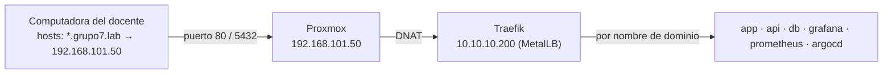

# 3. Red, MetalLB, Traefik y acceso (INF-06, NET-01 a NET-05, ACC-01, ACC-02)

## Direccionamiento

| Rango / IP | Uso |
|---|---|
| 192.168.101.0/24 | Red del grupo (donde se conectan las computadoras). Proxmox: **192.168.101.50** (`vmbr0`, cable) |
| 10.10.10.0/24 | Red del laboratorio (bridge `vmbr1` en Proxmox, con NAT hacia `vmbr0`) |
| 10.10.10.1 | Proxmox dentro del laboratorio: puerta de enlace, NFS y router de Tailscale |
| 10.10.10.10 – 10.10.10.12 | Nodos del clúster (control plane + 2 workers) |
| 10.10.10.200 – 10.10.10.220 | **Reservado para MetalLB** (INF-06). Ninguna VM usa estas IPs |
| 10.10.10.200 | Traefik: todas las URLs del grupo y PostgreSQL (puerto 5432) |

## MetalLB en capa 2 (NET-01)

`k8s/platform/metallb/config/pool.yaml` define el `IPAddressPool` `pool-grupo7` y el `L2Advertisement` `l2-grupo7`.

## Traefik (NET-02, NET-03, NET-04)

- Service `LoadBalancer` con IP fija por la anotación `metallb.io/loadBalancerIPs: 10.10.10.200` (`k8s/platform/traefik/values.yaml`).
- Entrypoints: `web` (puerto 80) y `postgres` (puerto 5432, TCP).
- Una `IngressRoute` por servicio web, cada una junto a su servicio:

| Dominio | Recurso | Archivo |
|---|---|---|
| app.grupo7.lab | IngressRoute | `k8s/apps/web/ingressroute.yaml` |
| api.grupo7.lab | IngressRoute | `k8s/apps/api/ingressroute.yaml` |
| db.grupo7.lab:5432 | IngressRouteTCP | `k8s/apps/database/ingressroutetcp.yaml` |
| grafana.grupo7.lab | IngressRoute | `k8s/observability/grafana/manifests/ingressroute.yaml` |
| prometheus.grupo7.lab | IngressRoute | `k8s/observability/prometheus/manifests/ingressroute.yaml` |
| argocd.grupo7.lab | IngressRoute | `k8s/argocd/ingress/ingressroute.yaml` |

## Acceso desde la red del grupo (ACC-01)



`scripts/proxmox/publicar-servicios.sh` deja en Proxmox un servicio de systemd que reenvía los puertos **80** y **5432** de la IP de Proxmox hacia Traefik (`10.10.10.200`). Traefik decide el servicio por el dominio. Por eso, en el archivo hosts basta con poner la IP de Proxmox (`docs/hosts.txt`).

En cada computadora:

1. Conectarse a la misma red que Proxmox.
2. Copiar `docs/hosts.txt` al final del archivo hosts:
   - Windows: `C:\Windows\System32\drivers\etc\hosts` (Bloc de notas como administrador)
   - Linux/macOS: `/etc/hosts`
3. Si Proxmox tiene otra IP en esa red, cambiar `192.168.101.50` en las 6 líneas.
4. Abrir http://app.grupo7.lab.

Si un navegador no respeta el archivo hosts, se debe a que usa DNS seguro (DoH). Desactívenlo en la configuración del navegador.

## VPN con Tailscale (ACC-02, acceso desde fuera de la red)

El host Proxmox funciona como *subnet router* y anuncia `10.10.10.0/24`:

```bash
curl -fsSL https://tailscale.com/install.sh | sh
tailscale up --advertise-routes=10.10.10.0/24 --accept-dns=false
```

1. Abrir el enlace que imprime e iniciar sesión con la cuenta del grupo.
2. En https://login.tailscale.com/admin/machines → la máquina `proxmox` → **Edit route settings** → aprobar `10.10.10.0/24`. Luego **Disable key expiry**.
3. Invitar al docente: **Users → Invite users**. El docente instala Tailscale, inicia sesión (en Linux, con `sudo tailscale up --accept-routes`) y usa la opción B de `docs/hosts.txt` (`10.10.10.200`).
