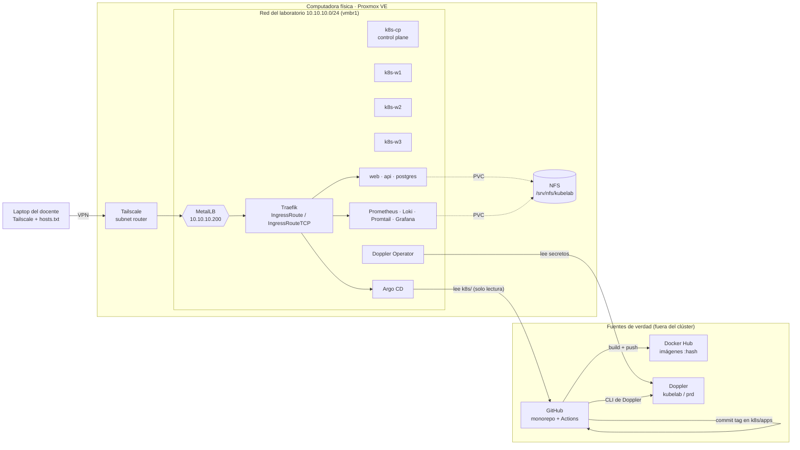

# Arquitectura

## Flujo de un cambio

1. Un integrante abre un pull request con cambios en `apps/api` o `apps/web`. El workflow de esa app corre las pruebas.
2. Al fusionarlo a `main`, el workflow vuelve a probar, construye la imagen y la publica en Docker Hub con el hash corto del commit (nunca `latest`).
3. El mismo workflow cambia la etiqueta en `k8s/apps/<app>/deployment.yaml` y hace commit (`ci(api): desplegar imagen abc1234`).
4. Argo CD detecta el commit (revisa cada 60 s) y sincroniza. Kubernetes hace un `RollingUpdate` con `maxUnavailable: 0`, así que no hay corte.
5. Si el cambio es solo en `k8s/`, no corre ningún workflow: Argo CD lo aplica directamente.

## Componentes y dónde se definen

| Componente | Namespace | Definición en el repo | Application de Argo CD |
|---|---|---|---|
| API (Node.js) | kubelab | `apps/api`, `k8s/apps/api` | `api` |
| Web (nginx) | kubelab | `apps/web`, `k8s/apps/web` | `web` |
| PostgreSQL 17 | kubelab | `k8s/apps/database` | `database` |
| MetalLB | metallb-system | chart + `k8s/platform/metallb/config` | `platform-metallb`, `platform-metallb-config` |
| Traefik | traefik | `k8s/platform/traefik/values.yaml` | `platform-traefik` |
| NFS provisioner (StorageClass por defecto) | nfs-provisioner | `k8s/platform/nfs/values.yaml` | `platform-nfs-storage` |
| metrics-server | kube-system | `k8s/platform/metrics-server/values.yaml` | `platform-metrics-server` |
| Doppler Operator + DopplerSecrets | doppler-operator-system | chart + `k8s/platform/doppler/secrets` | `platform-doppler-operator`, `platform-doppler-secrets` |
| Argo CD | argocd | `k8s/argocd/install`, `k8s/argocd/ingress` | `platform-argocd`, `platform-argocd-ingress` |
| Prometheus | monitoring | `k8s/observability/prometheus` | `observability-prometheus` |
| Loki | monitoring | `k8s/observability/loki` | `observability-loki` |
| Promtail | monitoring | `k8s/observability/promtail` | `observability-promtail` |
| Grafana + dashboard | monitoring | `k8s/observability/grafana` | `observability-grafana` |
